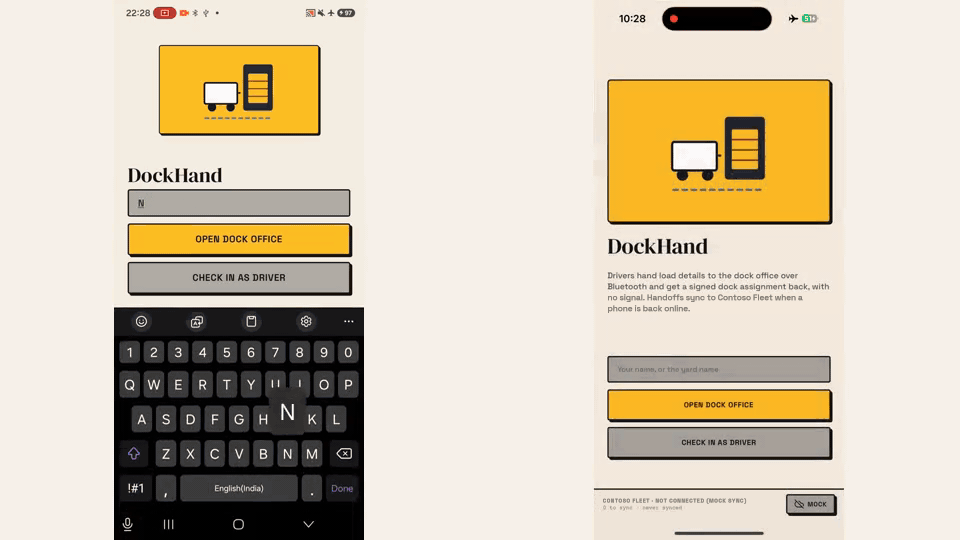

# DockHand

Driver to dock office handoffs with no signal, synced to a fleet platform when a phone is back online. A **driver** checks in with load details over **Bluetooth**; the **dock office** assigns a dock; both phones sign, so the handoff is a receipt neither side can change afterwards. When either phone reaches the internet, the handoff is written to the fleet platform as add-in data, next to the GPS fix the vehicle's tracker logged at check-in. No tracker hardware changes.

**Contoso Fleet** is a fictional fleet platform. The app syncs to a mock on the phone by default; the Contoso Fleet client shows the shape of a real integration (sign in, vehicles, GPS records, idempotent writes) and is tested against a fake server.

Built on `@offline-app-examples/mesh` and `@offline-app-examples/ui`, Mesh SDK 0.28.



## What it demonstrates

- **Offline handoff.** Check-in and dock assignment travel phone to phone over Bluetooth only. Check-ins are resent until the dock office acknowledges them, and every record has a stable `handoffId`, so resends never duplicate.
- **Signed receipts.** The driver signs the load details with the phone's mesh identity key (Ed25519). The dock office stores a check-in only if the signature verifies *and* the key belongs to the phone that sent it. It then countersigns the driver's exact check-in plus the dock. The driver checks that countersignature against its own copy of what it sent.
- **Sync when online.** Signed in to Contoso Fleet, a phone retries every 15 s while it has completed handoffs to sync, so taking a phone out of airplane mode is all it takes. Each record is checked by `handoffId` before it is added, so a retry, or both phones syncing, never makes a second record.
- **Tracker corroboration.** For a Contoso Fleet vehicle, the synced record carries the tracker's `GpsRecord` nearest to check-in time: independent evidence that the truck was at the yard.
- **Verification inside Contoso Fleet.** The `fleet-addin/` page lists the handoffs and checks both signatures in the browser, from the signed texts themselves. What it shows is what was signed.
- **Works without a server.** Not signed in, **Mock** sync runs the same duplicate check on the phone.

## Demo script (~5 min, two phones and a laptop)

The demo runs on the mock sync, with no sign-in. If you point the app at your own server that implements the Contoso Fleet API (below), sign both phones in first (bottom bar, then **Sign in**) and use **Sync** instead of **Mock**.

1. Put **both phones in airplane mode, then turn Bluetooth back on.** No signal from here on. Do this before anyone joins: in one device run, cutting Wi-Fi seconds after the join left dock assignments not reaching the driver until it left and rejoined.
2. **Phone A:** **Open dock office**, named e.g. "North Yard".
3. **Phone B:** **Check in as driver**, e.g. "Ada", and join North Yard.
4. **B:** pick a vehicle, keep or edit the load, **Sign and check in**.
5. **A:** the check-in appears. Tap **Dock 3**.
6. **B:** shows **Dock 3 · Driver + yard signed**. The bottom bar says **1 to sync**.
7. **B:** leave the yard, then tap **Mock**. The bar shows **1 added**. (Signed in to a server, turning airplane mode off is enough: within 15 s the bar shows **1 added**.)
8. **B:** tap **Mock** again. It reports **1 duplicate dropped**: the same handoff is not added twice.
9. *(With a server)* **Laptop:** open the **Yard Handoffs** page (below). The handoff is there with both signatures valid and the GPS fix at check-in.

## Contoso Fleet API

Contoso Fleet is fictional, and `fleet.contoso.example` does not resolve. To sync to a real backend, run a server that answers the same small JSON-RPC API at `https://<server>/api` (see `src/services/fleetPlatform.ts`): `Authenticate`, `Get` for `Device`, `GpsRecord` and `AddInRecord`, and `Add` for `AddInRecord`. **Use a test database:** writes take effect immediately.

1. **Sign in on each phone:** bottom bar, then server, database, user, password. The password is sent once to `Authenticate` and never stored. Only the session is kept, on the phone, until **Sign out** or until it expires (the app then asks again).
2. **The page:** host `fleet-addin/yardHandoffs.html` and `yardHandoffs.js` together on any HTTPS host and register it with your platform using `fleet-addin/config.json`. The page expects the host to call it through `contosoFleet.addin.yardHandoffs` with an `api.call` function.

Records are `AddInRecord` under the add-in id `ADD_IN_ID` (`src/services/fleetPlatform.ts`, mirrored in `yardHandoffs.js`; a test keeps the two equal). Generate your own id for a real integration.

## Files

| File | What it does |
| --- | --- |
| `src/domain/handoff.ts` | Records, the exact texts each side signs, ledger rules, message validation |
| `src/domain/sync.ts` | What a Contoso Fleet record contains, which handoffs to sync, mock ingest |
| `src/services/fleetPlatform.ts` | Contoso Fleet JSON-RPC: sign in, vehicles, GPS records, idempotent AddInRecord write |
| `src/services/persist.ts` | AsyncStorage: handoffs, sync state, session |
| `App.tsx` | Room roles, signing and verifying, resend and auto-sync loops |
| `fleet-addin/` | The Contoso Fleet page and its Add-In config |

## Limits

- Bluetooth only, as in every app here. iPhone to Android works; keep phones within a few metres for the first join.
- The duplicate check is check-then-add. Two phones syncing the same handoff in the same second can both add it; the Contoso Fleet page shows it once. A server-side sync service would make it one transaction, and is what a production integration should use, with a service account instead of a driver's session on the phone.
- The page checks that both signatures are valid. It does not re-derive each phone's `off1…` address from its key; the phones did that when the records were made.
- Signature checks in the page need a browser with Ed25519 in WebCrypto (current Chrome, Edge, Safari and Firefox). Older browsers show "cannot check".
- The page and the Contoso Fleet client are tested against a fake server, not a live one. Run the demo once against your own test server before showing it with sign-in.

## Run

From the monorepo root:

```sh
pnpm install
cd apps/dockhand/ios && bundle exec pod install && cd ../../..
pnpm --filter @offline-app-examples/dockhand dev
```

Second terminal:

```sh
pnpm --filter @offline-app-examples/dockhand ios -- --device
# or
pnpm --filter @offline-app-examples/dockhand android
```

Use **two physical phones** with Bluetooth on. Debug builds need Metro, which needs the network; for the airplane-mode demo install a **Release** build.

## Reset demo

Clear app data or reinstall. Records already written to a server stay there; remove them through its API (`Remove` on `AddInRecord`) or use a fresh test database.

## Tests

```sh
pnpm --filter @offline-app-examples/dockhand test
```

Covers the signed texts, ledger dedupe and single assignment, message validation, the record size limit, GPS fix selection, mock ingest, the Contoso Fleet client against a fake server (sign-in redirect, duplicate check, expired session), and the Contoso Fleet page verifying real Ed25519 signatures and rejecting edits.

## Licensing

Example app code: [MIT-0](../../LICENSE). `@offline-protocol/mesh-sdk` is [AGPL-3.0-only or commercial](https://www.offlineprotocol.com/docs/operations/licensing). Contoso Fleet is a fictional company.
